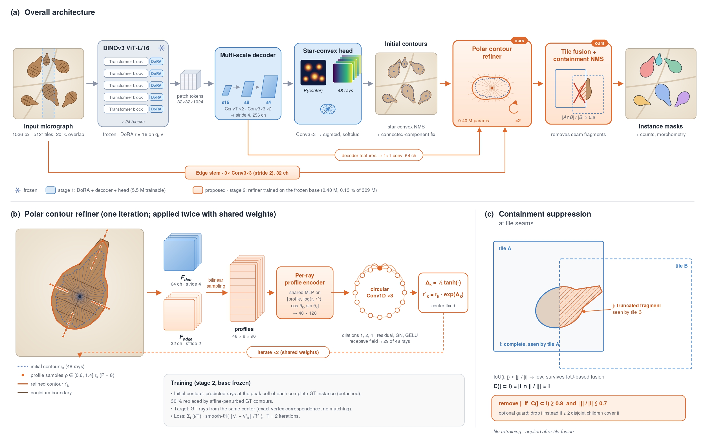

<div align="center">

# cIEF-Net

**Instance-level segmentation of *Alternaria alternata* conidia and few-shot adaptation across fungal taxa**

[](https://doi.org/10.5281/zenodo.24371322)
[](#installation)
[](#installation)
[](LICENSE)

</div>

cIEF-Net segments every conidium in bright-field micrographs of fungal cultures,
including touching conidia in dense fields, and adapts to new fungal taxa from
five or ten annotated images. It combines a frozen **DINOv3** vision
transformer adapted with **DoRA**, a **star-convex** instance representation and
a **polar harmonic contour refiner**.

This repository contains the code to train, evaluate and apply cIEF-Net and to
reproduce the experiments of the paper.

<!-- Architecture figure: save it as docs/figures/architecture.jpg -->
<p align="center">
  
</p>
<p align="center"><em>Architecture of cIEF-Net.</em></p>

## Contents

- [Method](#method)
- [Results](#results)
- [Datasets](#datasets)
- [Installation](#installation)
- [Pretrained models](#pretrained-models)
- [Quick start: segmenting new images](#quick-start-segmenting-new-images)
- [Training and evaluation](#training-and-evaluation)
- [Reproducing the paper](#reproducing-the-paper)
- [Repository structure](#repository-structure)
- [Citation](#citation)
- [License](#license)

## Method

| Component | Description |
|---|---|
| **Encoder** | DINOv3 ViT-L/16 (distilled, about 300 M parameters), frozen. A 512 x 512 tile becomes a 32 x 32 token grid. |
| **Adaptation** | DoRA adapters (r = 16, alpha = 32) in the query and value projections of all 24 blocks. |
| **Decoder** | Two transposed convolutions and two 3 x 3 convolutions (256 channels): stride 16 to stride 4. |
| **Star-convex head** | Centre probability and distances to the boundary along 48 rays. Distances are regressed in log space and weighted by proximity to the boundary. |
| **Polar contour refiner** | Samples decoder features and an RGB edge stem along every ray (0.6 r to 1.4 r), mixes the 48 rays with dilated circular convolutions, projects the log-ratio correction on the angular harmonics 0..K (K = 24, the full band) and applies `r' = r exp(0.5 tanh(Pi_K(delta)))` twice with shared weights. About 0.40 M parameters. |
| **Inference** | Images rescaled to a longest side of 1536 px (target taxa: a support-calibrated side), 512-px tiles with 20% overlap, polygon NMS, refinement, tile merging, and **containment suppression** of tile-border fragments (tau = 0.8, rho = 0.7, merge protection). |
| **Few-shot adaptation** | All trainable parts fine-tuned for 20 epochs on 5 or 10 support images, after scaling the images so that the median conidium diameter of the support set matches that of *A. alternata*. |

Training has two stages: (1) adapters, decoder and head for 30 epochs; (2) the
refiner for 15 epochs with everything else frozen. The configuration of the
refiner (harmonic order K) was selected by four-fold cross-validation on the
training images (`experiments/02_refiner_selection_cv.sh`).

## Results

Source domain, *A. alternata* test set (30 images, mean over three training runs):

| Model | AJI | PQ | DQ | SQ | Boundary IoU | Counting MAE |
|---|---|---|---|---|---|---|
| [Mask R-CNN](https://github.com/pytorch/vision) | 0.705 | 0.702 | 0.815 | **0.860** | 0.330 | 37.3 |
| [Cellpose-SAM](https://github.com/MouseLand/cellpose) | 0.697 | 0.692 | 0.814 | 0.850 | **0.337** | 28.7 |
| [StarDist](https://github.com/stardist/stardist) | 0.716 | 0.736 | 0.871 | 0.844 | 0.309 | 18.1 |
| [YOLO11m-seg](https://github.com/ultralytics/ultralytics) | 0.718 | 0.720 | 0.855 | 0.842 | 0.301 | 20.5 |
| **cIEF-Net** | **0.776** | **0.786** | **0.918** | 0.856 | **0.337** | **15.4** |

Few-shot adaptation, PQ of cIEF-Net (mean over four support sets):

| Target domain | 5 images | 10 images |
|---|---|---|
| *Lasiodiplodia* spp. | 0.828 | 0.840 |
| *Colletotrichum siamense* | 0.822 | 0.831 |
| *Neopestalotiopsis* sp. | 0.800 | 0.821 |
| *Hortaea werneckii* | 0.746 | 0.754 |

Complete results, standard deviations and paired image-level tests are
reported in the accompanying manuscript.

### Comparison methods

The benchmark compares cIEF-Net with four methods, each representing a
different strategy for forming instances. They were trained with their public
implementations (this repository contains only cIEF-Net); the settings used
are listed in [`baselines/README.md`](baselines/README.md).

| Method | Instance formation | Implementation |
|---|---|---|
| Mask R-CNN (He et al., 2017) | region proposals and per-box masks | [pytorch/vision](https://github.com/pytorch/vision) |
| Cellpose-SAM (Pachitariu et al., 2025) | flow fields and gradient tracking | [MouseLand/cellpose](https://github.com/MouseLand/cellpose) |
| StarDist (Schmidt et al., 2018) | star-convex polygons | [stardist/stardist](https://github.com/stardist/stardist) |
| YOLO11m-seg (Jocher and Qiu, 2024) | one-stage detection with mask prototypes | [ultralytics/ultralytics](https://github.com/ultralytics/ultralytics) |

## Installation

```bash
git clone https://github.com/ief-udb/cIEF-Net.git
cd cIEF-Net
conda env create -f environment.yml      # or: pip install -r requirements.txt
conda activate cief-net
pip install -e .
```

The experiments of the paper were run on Ubuntu with an NVIDIA RTX PRO 5000
(48 GB) GPU. The code requires Python 3.10 or later and PyTorch 2.x;
inference also runs, slowly, on CPU.

**DINOv3 weights.** The encoder is downloaded from the Hugging Face Hub
(`facebook/dinov3-vitl16-pretrain-lvd1689m`). The DINOv3 checkpoints are
gated: accept the DINOv3 license on the model page and run
`huggingface-cli login` once. A local copy can be used with
`--backbone /path/to/folder`.

## Datasets

[](https://doi.org/10.5281/zenodo.24371322)

The study uses one source collection and four target collections of
bright-field micrographs, annotated at the instance level (one polygon per
conidium).

| Taxon | Role | Training / support images | Test images | Total images | Annotated conidia | Conidia per image (mean +- SD) |
|---|---|---|---|---|---|---|
| *Alternaria alternata* ATCC 20084 | source | 116 | 30 | 146 | 24 686 | 169.1 +- 154.8 |
| *Lasiodiplodia* spp. (four species) | target | 53 | 117 | 170 | 518 | 3.0 +- 2.6 |
| *Colletotrichum siamense* | target | 39 | 20 | 59 | 912 | 15.5 +- 16.4 |
| *Neopestalotiopsis* sp. | target | 45 | 38 | 83 | 374 | 4.5 +- 4.6 |
| *Hortaea werneckii* | target | 24 | 63 | 87 | 11 135 | 128.0 +- 71.1 |
| **Total** | | | | **545** | **37 625** | |

For the target taxa, the training/support column counts the distinct images
used by any of the support sets (5 and 10 images, four seeds).

* **Acquisition of the institutional collections** (*A. alternata*,
  *H. werneckii*): Motic Panthera L microscope, bright field, 100x with
  immersion oil, images captured through the eyepiece with smartphones.
  *A. alternata* images range from 1.31 to 7.99 megapixels (median 6.99), in
  two acquisition-resolution groups; *H. werneckii* images range from 1.23 to
  50.14 megapixels (median 12.53).
* **Density.** *A. alternata* is the densest collection, with up to 693
  conidia in one image and frequent touching or overlapping conidia.
* **Curation.** Near-duplicate images were screened before partitioning
  (ORB keypoints with RANSAC verification and EfficientNet-B0 embedding
  clusters; see [`curation/`](curation/)).
* **Partitions.** The *A. alternata* training set is divided into four
  cross-validation folds stratified by instance density and resolution group;
  target collections have a fixed test set and support sets of 5 and 10
  images drawn with seeds 42, 7, 123 and 2024.

The *A. alternata* and *H. werneckii* images, all instance annotations and
the partition manifests are available on
**[Zenodo](https://doi.org/10.5281/zenodo.24371322)** under CC BY-NC 4.0. The
TgFC images (*C. siamense*, *Neopestalotiopsis* sp.) are available from their
original publication under CC BY 4.0; the *Lasiodiplodia* images are subject
to the permission of their rights holders.

The expected folder layout and file formats are documented in
[`data/README.md`](data/README.md):

```
data/
├── alternaria_alternata/images/      images + LabelMe .json
├── lasiodiplodia/images/
├── colletotrichum_siamense/images/
├── neopestalotiopsis/images/
├── hortaea_werneckii/images/
└── splits/
    ├── alternaria_alternata.csv                      image,fold
    └── fewshot/<species>/<N>shot_s<seed>.csv         image,species,subset
```

## Pretrained models

| Model | Training data | File |
|---|---|---|
| cIEF-Net (base + harmonic refiner K = 24), seed 42 | *A. alternata* | **[link to be added]** |
| Base network (stage 1), seed 42 | *A. alternata* | **[link to be added]** |

Place the files under `checkpoints/` (see [`checkpoints/README.md`](checkpoints/README.md)).
Each checkpoint folder contains `checkpoint.pt`, `model_config.json` and
`diameter_calibration.json`.

## Quick start: segmenting new images

```bash
python scripts/predict.py \
    --checkpoint checkpoints/cief_net_alternaria/checkpoint.pt \
    --input path/to/micrographs/ --out predictions/ --save-overlay --labelme
```

For every image this writes a 16-bit instance label image at the original
resolution, an optional overlay, optional LabelMe polygons (ready for manual
correction), and two tables: `instances.csv` (area, equivalent diameter,
centroid and elongation of every conidium, in pixels) and `counts.csv`.

Images of another taxon or magnification should be processed at a comparable
apparent conidium size: either fine-tune on a few annotated images
(`--mode fewshot`, which calibrates the scale automatically) or pass
`--ref-side` so that the conidia measure about 28 pixels in diameter at the
working scale.

## Training and evaluation

```bash
# Stage 1: base network
python scripts/train.py --mode holdout \
    --images-dir data/alternaria_alternata/images \
    --split-csv data/splits/alternaria_alternata.csv \
    --out runs/base_s42 --epochs 30 --lr-t-max 60 --seed 42

# Stage 2: harmonic refiner on the frozen base
python scripts/train.py --mode holdout \
    --images-dir data/alternaria_alternata/images \
    --split-csv data/splits/alternaria_alternata.csv \
    --out runs/cief_net_s42 --init-checkpoint runs/base_s42/checkpoint.pt \
    --use-refiner --refiner-only --epochs 15 --lr-new 3e-4 --seed 42

# Evaluation on the test set with the paper post-processing
python scripts/evaluate.py --checkpoint runs/cief_net_s42/checkpoint.pt \
    --images-dir data/alternaria_alternata/images \
    --split-csv data/splits/alternaria_alternata.csv --subset test \
    --paper-postprocessing --out runs/cief_net_s42/eval_test

# Few-shot adaptation to a new taxon
python scripts/train.py --mode fewshot \
    --images-dir data/hortaea_werneckii/images \
    --fewshot-csv data/splits/fewshot/hortaea_werneckii/5shot_s42.csv \
    --init-checkpoint runs/cief_net_s42/checkpoint.pt \
    --use-refiner --paper-postprocessing \
    --epochs 20 --lr-backbone 2e-6 --lr-new 2e-5 --seed 42 \
    --out runs/fewshot/hortaea_werneckii/cief_net/5shot/s42
```

All reported results use the weights of the **last epoch** (`checkpoint.pt`).
Every run directory contains `summary.json`, `per_image_metrics.csv`,
`history.json`, `model_config.json` and `diameter_calibration.json`. Run any
script with `--help` for all options.

Other tools:

| Script | Purpose |
|---|---|
| `scripts/diagnose_errors.py` | Error decomposition: matched-instance shape errors, spectral analysis of the radial contour error with oracle refinement, detection error types, stratification by size, elongation and crowding, containment-threshold sensitivity. |
| `scripts/paired_tests.py` | Paired image-level comparisons (bootstrap CI, Wilcoxon signed-rank, Holm). |
| `scripts/select_refiner_cv.py` | Aggregation and selection rule of the cross-validation experiment. |
| `scripts/aggregate_runs.py` | Mean and SD over seeds. |
| `scripts/visualize_predictions.py` | Annotation versus prediction figures. |
| `scripts/plot_history.py` | Training and validation curves. |
| `scripts/convert_legacy_checkpoint.py` | Converts checkpoints of the original implementation. |
| `scripts/prepare_splits.py` | Copies partition manifests into the layout of `data/splits/`. |

## Reproducing the paper

| Paper | Script |
|---|---|
| Source-domain benchmark, ablation and paired tests (*A. alternata*) | `experiments/01_alternaria.sh` |
| Selection of the refinement configuration by cross-validation | `experiments/02_refiner_selection_cv.sh` |
| Few-shot adaptation to the four target domains | `experiments/03_fewshot.sh` |
| Spectral and stratified error analysis, containment sensitivity | `experiments/04_diagnostics.sh` |

Hyperparameters are collected in `experiments/config.sh`. Details, including
the evaluation conventions and notes on determinism, are in
[`docs/reproducibility.md`](docs/reproducibility.md). The comparison methods
(Mask R-CNN, Cellpose-SAM, StarDist, YOLO11m-seg) were trained with their
public implementations, linked in [Comparison methods](#comparison-methods).

## Repository structure

```
cIEF-Net/
├── cief_net/                 library
│   ├── model.py              encoder + DoRA, decoder, star-convex head, refiners
│   ├── losses.py             log-radial loss with boundary weighting, refiner loss
│   ├── data.py               tile dataset and star-convex targets
│   ├── inference.py          tiled inference, decoding, evaluation
│   ├── containment.py        containment suppression of tile-border fragments
│   ├── metrics.py            AJI, PQ/DQ/SQ, Boundary IoU, Dice, mAP, counting error
│   ├── calibration.py        support-derived scale calibration
│   ├── diagnostics.py        error decomposition
│   ├── engine.py             training loop
│   ├── augmentations.py, tiling.py, io.py, checkpoints.py, cli.py
├── scripts/                  command-line tools
├── experiments/              reproduction scripts of the paper
├── data/                     datasets and partition manifests (not versioned)
├── checkpoints/              pretrained weights (not versioned)
├── baselines/                settings of the comparison methods (links to their code)
├── curation/                 dataset curation tools
├── docs/                     reproducibility notes and figures
└── tests/                    unit tests (pytest)
```

## Citation

The manuscript describing cIEF-Net is in preparation; citation details will
be added here. Until then, please cite this repository (see also
[`CITATION.cff`](CITATION.cff)):

```bibtex
@software{ciefnet2026,
  title  = {{cIEF-Net}: instance segmentation of fungal conidia and few-shot adaptation across fungal taxa},
  author = {Ojeda, Sebastian and Cely, Sebastian and Aguilera, Astrid M. and Moreno, Elkin Alfredo and
            Guerrero Arroyave, Claudia Patricia and Correal Cuervo, Sergio Andres},
  year   = {2026},
  url    = {https://github.com/ief-udb/cIEF-Net}
}
```

Sebastian Ojeda and Sebastian Cely contributed equally.

## License

The original code, trained model components and annotations of this project
are released under the [Creative Commons Attribution-NonCommercial 4.0
International license](LICENSE) (CC BY-NC 4.0). Third-party components keep
their own licenses: DINOv3 weights (DINOv3 License, Meta), `stardist`
(BSD-3-Clause), Hugging Face `transformers` and `peft` (Apache-2.0), and the
TgFC images (CC BY 4.0).

## Acknowledgements

We thank the Universidad de Boyacá, particularly its Vice-Rectorate for
Research, for supporting this research, and Alexis Crespo-Michel, Miguel A.
Alonso-Arévalo and Rufina Hernández-Martínez for providing the
*Lasiodiplodia* images. cIEF-Net builds on
[DINOv3](https://github.com/facebookresearch/dinov3),
[StarDist](https://github.com/stardist/stardist),
[PEFT](https://github.com/huggingface/peft) and
[torchmetrics](https://github.com/Lightning-AI/torchmetrics).
